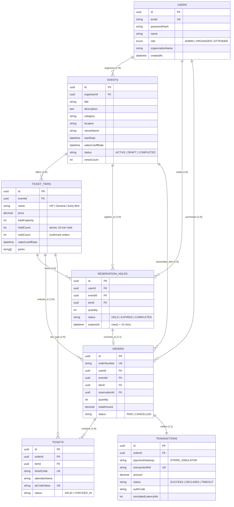

# EventPulse: Multi-Tenant Event & Ticket Reservation System

EventPulse is a multi-tenant event management and ticket reservation platform built with React, Vite, Node.js, Express, PostgreSQL, Prisma, and Redis. It is engineered to handle heavy concurrent booking spikes without double-booking seats through atomic transactions and row locking, with a 10-minute temporary reservation hold engine, asynchronous payment gateway simulation, and real-time organizer analytics.

---

## 1. System Architecture & Core Problem Solutions

### Concurrent Booking Protection (0% Double-Booking Guarantee)
- **Problem**: When 100 users attempt to purchase the last 3 tickets for a popular festival or keynote at the exact same millisecond, standard database queries suffer from race conditions where multiple requests read available capacity before updating it, resulting in oversold seats.
- **Solution**: We implement transactional row locking (`SELECT * FROM "TicketTier" WHERE id = $1 FOR UPDATE`) combined with atomic in-memory mutex queues. The transaction atomically validates that `totalCapacity - (soldCount + heldCount) >= requestedQuantity`, increments `heldCount`, and generates a hold record. Any request exceeding capacity is rejected with `409 Conflict`.

### 10-Minute Temporary Reservation Holds
- When an attendee selects seats, an atomic hold is placed with `expiresAt = now() + 10 minutes`.
- The seats are removed from general availability while the customer completes payment details.
- If checkout is completed within 10 minutes, the hold is marked `COMPLETED`, `heldCount` is decremented, and `soldCount` is incremented.

### Background Cron Worker (Expired Hold Release)
- A background worker runs every 5 seconds checking for any reservation where `status = 'HELD'` and `now() >= expiresAt`.
- Expired seats are returned to general inventory atomically, and the Redis cache is invalidated.

### Caching Layer with Redis
- High-read event listings and tier availabilities are cached in Redis with a 30-second TTL.
- Cache invalidation triggers automatically upon hold creation, hold expiration, cancellation, or checkout completion.

---

## 2. Entity Relationship (ER) Data Model



---

## 3. Quick Start on Windows in VS Code

### Prerequisites
1. **Node.js**: Install v20 LTS or v22 LTS from [nodejs.org](https://nodejs.org).
2. **VS Code**: Install from [code.visualstudio.com](https://code.visualstudio.com).
3. **PostgreSQL & Redis**: Install locally on Windows or run via Docker Desktop:
   ```bash
   docker compose up -d
   ```

### Setup Steps (PowerShell)
```powershell
# 1. Clone or open the project folder
cd eventpulse

# 2. Install dependencies
npm install

# 3. Configure environment variables in .env
# Copy from .env.example
cp .env.example .env

# 4. Run Prisma database migrations
npx prisma migrate dev --name init

# 5. Seed the database with demo users and events
npx prisma db seed

# 6. Start full-stack development server (Express backend + Vite frontend)
npm run dev
```


---


